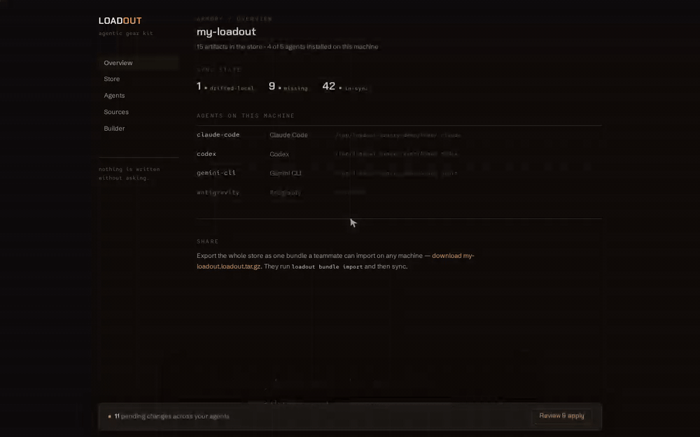

<p align="center">
  
</p>

# loadout

Your agentic gear kit. loadout keeps AI-agent configs — skills, instructions, slash commands, hooks, settings — in one canonical, git-friendly store and installs them into each coding agent's native home through pluggable adapters.

Skills use the open [Agent Skills](https://agentskills.io) standard (`SKILL.md`), so the canonical format is the native format: loadout places them, tracks them, and keeps them in sync everywhere.

**Current release: v1.0.0** — canonical store, sync engine with drift detection, all five agent adapters, external git sources, shareable bundles, builder wizard with crash-safe SDD, AI drafting via your logged-in agents, TUI and embedded web UI ([ROADMAP.md](ROADMAP.md) — v1 complete).

**New here? Read [EXAMPLES.md](EXAMPLES.md)** — a hands-on walkthrough ending with a real Claude session using loadout-installed `/spec` and `/handoff`.

<p align="center">
  
</p>

## Why

Agent configs are fragmented across `~/.claude`, `~/.codex`, `~/.gemini`, `~/.cursor` and project `.agents/` directories: no sync, no versioning, no team-sharing, no reinstall story. loadout treats them like dotfiles with a package manager on top:

- **One canonical store** — a plain directory (and git repo) holding your whole setup.
- **Pluggable adapters** — install into Claude Code, Codex, Gemini CLI, Antigravity and Cursor.
- **Drift detection** — see per artifact and per agent what is in sync, edited on disk, updated in the store, or missing.
- **Never writes without asking** — every apply goes through a confirmation gate; user-authored content outside loadout's managed blocks is never touched.

## Install

```bash
curl -fsSL -H "Authorization: Bearer $GITHUB_TOKEN" \
  https://raw.githubusercontent.com/AxeForging/loadout/main/install.sh | sh
```

The installer downloads the release for your platform and verifies its SHA-256
checksum. Because Loadout is private, `GITHUB_TOKEN` must be able to read the
repository. Set `LOADOUT_VERSION=v1.4.0` to pin a release or
`LOADOUT_INSTALL_DIR=~/.local/bin` to choose the destination. `go install
github.com/AxeForging/loadout/cmd/loadout@latest` remains supported.

## Pull request quality gates

PR validation runs [Structlint](https://github.com/AxeForging/structlint) and
[Dupehound](https://github.com/AxeForging/dupehound) through
[Gauntlet](https://github.com/AxeForging/gauntlet). Structural findings apply to
the whole run; duplication findings are scoped to lines changed by the PR.

## Quick start

```bash
loadout init                      # create the canonical store
loadout new skill code-review    # scaffold a skill (SKILL.md standard)
loadout new instruction style    # shared instructions for every agent
loadout status                   # drift matrix: artifact × agent
loadout sync                     # install into detected agents (asks first)
```

## Commands

| Command | Purpose |
|---------|---------|
| `loadout init` | Create the canonical store (git-friendly directory with a starter manifest) |
| `loadout status [artifact...]` | Drift matrix: every artifact's sync state per agent |
| `loadout diff [artifact...]` | Unified diffs of what sync would change |
| `loadout sync [artifact...]` | Install/update artifacts in agent homes — always asks before writing (`--dry-run`, `--yes`, `--agent`, `--force`, `--project` for project-scoped MCP configs) |
| `loadout install <agent>` | First-time full install into one agent (`--force`) |
| `loadout restore [snapshot-id]` | List pre-write snapshots, or restore one (`--yes`) — recover files an overwrite replaced |
| `loadout new <kind> <name>` | Scaffold a `skill`, `instruction`, `command`, `hook` or `mcp` — or draft a skill with `--ai "description"` via your logged-in agent |
| `loadout add <path>` | Adopt an existing native artifact (skill/hook/mcp dir, command/instruction file) into the store |
| `loadout source add\|list\|remove <url>` | Track skills from external git repos (pinned in `sources.lock.yaml`) |
| `loadout check` | Check sources for updates — `git ls-remote` only, nothing fetched or applied |
| `loadout update [source]` | Fetch updates, show changelog + artifact diff, apply to the store after confirmation |
| `loadout bundle export [--archive\|--flat]` | Export the store as a shareable directory, `.loadout.tar.gz`, or a single self-contained `.loadout.yaml` document (`--flat`) — everything by default, or exactly `--artifacts`/`--profiles`/`--library` (repeatable) plus `--sources` |
| `loadout bundle import <path>` | Validate a bundle (directory, `.tar.gz`, or flat YAML — auto-detected), show the merge plan (`--on-conflict skip\|overwrite`), apply after confirmation |
| `loadout spec init\|list\|status\|check\|uncheck\|sync` | Spec-driven development: numbered specs whose checklists live in the files or in one GitHub issue per spec (`--backend github`, via your `gh` CLI). `check` is the agents' completion loop; `status --require-complete` is a CI gate |
| `loadout wizard` (alias `create`) | Guided builder: stack + engineering conventions + SDD → generated skills/instructions/commands (`--preset`, `--profile`, `--answers`, `--save-profile`, `--yes`). Set an optional namespace prefix so generated commands become `/af-plan`, `/af-spec`, … instead of clashing with agent built-ins like `/plan` |
| `loadout profile list\|show\|rm` | Save, list, inspect and delete named wizard answer sets (see `--save-profile` above) |
| `loadout loadouts save\|list\|show\|switch\|rm` | Named, switchable sets of active artifacts — `switch` installs the set and removes whatever isn't in it (always asks before writing) |
| `loadout tui` (alias `dash`) | Interactive dashboard: drift matrix, store browser with preview, sources, diff view, gated sync |
| `loadout serve` | Local web UI on `127.0.0.1:4600` — overview, store browser, drift matrix with diffs, sources, the Builder, bundle export/import |
| `loadout agents` | List supported agents and whether they are installed |
| `loadout doctor` | Verify the store, agent homes, managed-block markers and install state |
| `loadout version` | Print build version information |
| `loadout completion <shell>` | Shell completion scripts (bash, zsh, fish) |

Global flags: `--store <path>` (env `LOADOUT_STORE`), `--log-level` (env `LOADOUT_LOG_LEVEL`), `--no-color`.

## The canonical store

By default at `~/.local/share/loadout/store` (override with `storePath` in `~/.config/loadout/config.yaml` or `--store`). It is a plain directory — point it at your dotfiles repo if you like:

```
store/
├── loadout.yaml            # manifest: artifacts, kinds, targets
├── skills/<name>/SKILL.md  # Agent Skills standard, verbatim
├── instructions/*.md       # concatenated into managed blocks in CLAUDE.md etc.
├── commands/<name>.md      # slash-command prompts
├── hooks/<name>/           # hook.yaml (event/matcher/timeout) + run.sh
├── settings/<agent>.yaml   # per-agent settings fragments (merged, never replaced)
└── mcps/<name>/mcp.yaml    # MCP server definitions (merged into each agent's native MCP config)
```

Machine-local install state (content hashes per artifact × agent) lives separately in the platform data dir — the store repo stays shareable.

### Sync states

| State | Meaning |
|-------|---------|
| `in-sync` | Agent file matches the store |
| `missing` | Not installed yet |
| `drifted-local` | The agent file was edited after install |
| `drifted-store` | The store was updated after install |
| `conflict` | Both changed, or an unmanaged file is in the way |
| `n/a` | The agent does not support this artifact kind |

### Managed blocks

Instructions render into agents' global instruction files (e.g. `~/.claude/CLAUDE.md`) between sentinel markers:

```markdown
<!-- loadout:begin style -->
...your instruction content...
<!-- loadout:end style -->
```

Everything outside the markers is preserved byte-for-byte. Hooks and settings fragments deep-merge into `settings.json` instead of replacing it.

## MCP servers — one definition, every agent

Define an MCP server once and loadout merges it into each agent's native MCP config:

```bash
loadout new mcp github     # scaffolds mcps/github/mcp.yaml — edit it
loadout sync               # merges it into every agent's MCP config (asks first)
```

Prefer a form over YAML? The web UI (`loadout serve`) has a dedicated **MCP** page: pick the transport, fill command/args or URL, add `${VAR}`-placeholder env/headers, and it lands in the store with the same validation — installing into agents still goes through the gated sync.

```yaml
# mcps/github/mcp.yaml
transport: stdio            # stdio (default) | http | sse
command: npx
args: ["-y", "@modelcontextprotocol/server-github"]
env:
  GITHUB_TOKEN: ${GITHUB_TOKEN}   # placeholders only — see below
scope: user                 # user (global config) | project
```

Where it lands (always deep-merged — only the `mcpServers.<name>` entry loadout manages is touched; your other servers and settings are preserved):

| Agent | `scope: user` | `scope: project` |
|-------|---------------|------------------|
| Claude Code | `~/.claude.json` | `<project>/.mcp.json` |
| Gemini CLI | `~/.gemini/settings.json` | `<project>/.gemini/settings.json` |
| Cursor | `~/.cursor/mcp.json` | `<project>/.cursor/mcp.json` |
| Codex / Antigravity | `n/a` for now (see ROADMAP) | — |

Project scope resolves against `--project <dir>`, or the current directory when it contains a `.git` (no walk-up, no guessing — without a project root the artifact reports `n/a`).

**Secrets never enter the store.** Env and header values under secret-looking keys (`*_KEY`, `*_TOKEN`, `*_SECRET`, `*password*`, `Authorization`) must be `${VAR}` placeholders — they are written to agent configs verbatim and resolve from your environment at agent runtime. Literal values are rejected at `new`/`add`, by `loadout doctor`, at bundle import, and again at sync render time. Removing an MCP artifact clears its install record but leaves the merged JSON entry in place (same as hook settings fragments) — clean it up manually for now.

## Safety: conflicts and snapshots

loadout will never silently destroy config you already had. Two guards protect a newcomer who imports someone else's bundle and syncs:

- **Conflicts are skipped by default.** A whole-file artifact (skill, command, hook script) whose target already exists on disk but was *never installed by loadout* is reported as a `conflict` and left untouched. `sync` tells you what it skipped and stops there. Re-run with `--force` to overwrite them on purpose — for example when a store's `plan` command collides with a `~/.claude/commands/plan.md` you wrote yourself. Files loadout provably installed (`drifted-local`) still re-converge on a normal sync; only genuinely-unowned files need `--force`.

- **A snapshot is taken before any overwrite or delete.** Right before `sync`, a loadout `switch`, or a `--force` write touches an existing file, loadout copies the originals into a timestamped snapshot under the machine-local data dir (`<data>/loadout/backups/<timestamp>/`). Recover them any time:

  ```
  loadout restore                 # list snapshots, newest first
  loadout restore 20260709-150257 # restore that snapshot (asks first)
  ```

  Restores are themselves snapshotted, so they're undoable too. loadout keeps the most recent snapshots and prunes older ones — configure the count with `backups.keep` in `~/.config/loadout/config.yaml` (default 10; a negative value keeps all). Snapshots never touch install state, so `loadout status` stays honest after a restore.

## External sources

Track skill repos (yours, your team's, public collections) and stay pinned:

```bash
loadout source add git@github.com:acme/team-skills.git
loadout check            # ls-remote only — never fetches or applies
loadout update           # shows changelog + per-skill diff, asks, applies to the STORE
loadout sync             # then rolls the store out to your agents (asks again)
```

Pins live in `sources.lock.yaml` inside the store, so a shared store reproduces the exact same skill versions everywhere. Git operations shell out to your system `git` — private repos work through your existing SSH agent or credential helper, and loadout never stores credentials. Skills you edited locally (origin `local`) are never overwritten by updates; skills that disappear upstream are kept and relabeled `local`, never deleted.

Optional passive checking (off by default) in `~/.config/loadout/config.yaml`:

```yaml
updates:
  checkOnRun: true     # after status/sync, print at most one hint line
  intervalHours: 24    # cache window; failures are always silent
```

## The wizard — conventions in, artifacts out

`loadout wizard` interviews you about what you build (app types, languages, toolchain, docker), your **engineering conventions** (lefthook git hooks, linters, branching model, commit convention, PR-title convention), your **testing strategy** (which levels are mandatory — unit/component/integration/e2e — per framework and runner, plus a mocking policy) and whether you want **spec-driven development** and **cross-agent context handoff**. Wherever the built-in options (Go, TypeScript, Python; a handful of package managers, linters, unit-test runners) don't cover your stack, an "Other" free-text field takes any custom value straight into the generated docs. It generates ready-to-sync artifacts:

- `core`, `toolchain`, `conventions`, `testing` instructions (managed blocks in every agent's instruction file)
- `custom-instructions` — your own house rules, one per line, only generated when you add at least one (see below)
- a `commit-and-pr` skill — commit/branch/PR rules with the validation regex, plus a ready `lefthook.yml` in its references
- a `linting` skill with run/fix commands per linter, and `docker-workflows` if you use docker
- `/plan` + `/spec` commands and an `sdd-workflow` skill (light or full spec templates)
- `/handoff` + `/resume` commands and a `context-handoff` skill (see below)

**Custom instructions** — the Standards station has a `standards.custom` field for house rules that don't fit the built-in questions (e.g. "always write tests before fixing a bug"). In the CLI it's a multiline field, one instruction per line; in the web Builder it's a row editor — type one, press Enter, click a row to edit it in place, delete rows individually. Any row can be saved to a store-wide **instruction library** (`store/library/instructions.yaml`) and re-added with one click in a later wizard run, so you don't retype the same house rules for every project. Library entries can be organized into **groups** (`store/library/groups.yaml`) — name a set of entries once, then add the whole set to a wizard run in one click instead of picking each individually. The web UI's **Library** page is the dedicated place to browse, search, delete, and manage groups; entries are content-addressed, so the library never offers renaming an entry in place — delete and re-add if the wording needs to change.

Non-interactive: `loadout wizard --preset go-cli --yes` (presets: `go-cli`, `web-app`, `sdd`) or `--answers answers.yaml`. Existing artifacts are never overwritten — the wizard skips them. Everything generated is plain markdown in the store — edit freely, it's yours.

**Name the commands and skills yourself** — `/spec`, `/plan`, `/handoff`, `/resume` and the `sdd-workflow` skill each have a naming question (e.g. rename `sdd-workflow` to `fe-sdd-workflow` for a frontend-specific flow). Every generated cross-reference (the workflow skill mentioning `/plan`, the resume command's description, and so on) uses the name you chose — nothing is left pointing at the old one.

**Namespace prefix** — the Naming station asks for an optional prefix (e.g. `af`) that's applied to every *defaulted* command/skill name at once: `/plan` → `/af-plan`, `/spec` → `/af-spec`, and so on. This keeps generated commands from clashing with agents' built-in slash commands like `/plan`. An explicit per-name rename always wins over the prefix. Whenever a generated (or scaffolded, or imported) command/skill name would shadow a built-in, loadout prints an advisory `!` warning — in the wizard, `loadout new`, `loadout bundle import`, and `loadout doctor` — but never blocks it: shadowing is allowed when you mean to.

**Tell it how aggressively to change your codebase** — `sdd.changeScope` (minimal / balanced / thorough) becomes a "Change scope" section in the generated `sdd-workflow` skill: *minimal* scopes every change to the fewest files, insists on reusing existing code over duplicating it, and favors several small reviewable PRs; *thorough* allows broader changes when they clearly help; *balanced* (default) is the middle ground.

**Crash-safe by design** — `/plan` writes a checkbox-tracked plan file to disk next to the spec; a killed session (crash, restart, laptop closed) loses nothing, because `/resume` reads that file — not the conversation — and continues at the first unchecked step:

<p align="center">
  
</p>

## Spec-driven development — checklists agents can't lose

`loadout spec` manages numbered specs (`docs/specs/NNN-<name>.md`) whose checklist steps carry stable IDs, so completion state survives rewording, reordering, restarts and agent switches:

```markdown
- [ ] wire the adapter <!-- sdd:wire-adapter -->
```

```bash
loadout spec init checkout-flow      # claims the next number, scaffolds the template
loadout spec check 001 wire-adapter  # the completion loop — idempotent, byte-preserving
loadout spec status --require-complete   # CI gate: non-zero while steps are open
```

Where the checklist lives is per-project (`docs/specs/sdd.yaml`):

- **`backend: local`** (default) — state lives in the spec file itself.
- **`backend: github`** — one tracking issue per spec; `init` opens it (repo auto-detected from `origin`, labels configurable) and `check` updates the issue body. Requires the [`gh` CLI](https://cli.github.com) — loadout shells out to it, so your existing auth just works and loadout never stores a token. `loadout spec sync` reconciles file ↔ issue: structure always flows local → GitHub, while check-state divergence is reported and only resolved with an explicit `--from-local` / `--from-github` — never guessed.

The `sdd` wizard preset (`loadout wizard --preset sdd`) installs `/spec`, `/plan` and the `sdd-workflow` skill into every agent, all instructing the same loop: scaffold via `spec init`, mark steps with `spec check` the moment they're done, resume from `spec status`. One tested code path instead of four agents hand-editing checkboxes. `loadout spec` only touches project files — never the store or agent homes.

The wizard's spec-driven section also asks **where spec checklists live** (`sdd.backend`: local files or GitHub issues) — the generated `/spec` command, `sdd` instruction and workflow skill then all point at the matching `loadout spec init` invocation (`--backend github` when the team tracks specs in issues), in the CLI questionnaire and the web Builder alike.

## Profiles — reuse your answers across projects and teams

Presets (`go-cli`, `web-app`) are built in and read-only. Profiles are yours: save any wizard run's answers under a name, reuse them for the next repo, or commit them so your whole team starts from the same conventions.

```bash
loadout wizard --preset go-cli --save-profile acme-backend --yes   # save while generating
loadout wizard --profile acme-backend --yes                        # reuse it elsewhere
loadout profile list                                                # see what's saved
loadout profile show acme-backend                                   # print its answers
loadout profile rm acme-backend                                     # delete it
```

Profiles live at `store/profiles/<name>.yaml` — plain YAML in the canonical store, so they travel with it through git or a bundle. The web Builder has the same picker next to the preset chips, plus a "Save as profile" action on the review step. (Profiles save a whole answer set; the instruction library above saves individual custom-instruction lines — the two are independent and can be used together.)

## Loadouts — switch your active artifact set

A profile saves wizard *answers*; a **loadout** saves the *artifact set itself* — which skills, instructions, commands, hooks and settings are actually active. `loadout loadouts switch <name>` is a real switch: it installs everything the target loadout has, and **removes** whatever was previously installed but isn't in it — not just an additive sync.

```bash
loadout loadouts save frontend demo style   # save named artifacts as a loadout
loadout loadouts list                       # see what's saved (marks the active one)
loadout loadouts show frontend              # print its artifact list
loadout loadouts switch frontend            # install it, remove what's not in it — asks first
loadout loadouts rm frontend                # delete the definition only, never installed artifacts
```

The first time you touch the feature, loadout auto-saves a `default` loadout — a frozen snapshot of everything that was in the manifest at that moment — as a safety net you never have to think to create. `default` can never be saved over or removed, so `loadout loadouts switch default` is always there as a way back. `rm` only ever deletes a saved loadout's *definition*; real removal from agent homes only happens through `switch`, which always shows a plan and asks before writing.

One thing v1 doesn't remove automatically: hooks and settings fragments merged into `settings.json` (multiple artifacts can share that file, so there's no safe way yet to subtract just one artifact's contribution). Switching away from a loadout with hooks/settings leaves those files as-is and just stops tracking them — `loadout status`/`doctor` will flag them as installed-but-unmanaged if you want to clean them up by hand.

## Context handoff — continue anywhere

Session context dies with the session. The wizard's continuity artifacts standardize the fix across every agent:

- `/handoff` — the agent dumps a structured handoff (goal, current state, decisions, next steps, gotchas) to `.agents/context/handoff.md` in the project.
- `/resume` — any agent (Claude Code, Codex, Gemini CLI, …) reads it, verifies it against git state, and continues.

Dump from Claude Code, resume in Codex. Or restart tomorrow and pick up exactly where you left off.

## AI drafting — powered by the agents you already pay for

If you're logged into Claude Code, Codex or Gemini CLI, loadout can use them headlessly (`claude -p`, `codex exec` read-only, `gemini -p`) — no API keys, it rides your existing plan:

```bash
loadout new skill release-notes --ai "draft release notes from merged PRs since the last tag"
loadout wizard --preset web-app --ai        # deepens testing/conventions/toolchain for your exact stack
loadout agents                               # HEADLESS column shows what's available
```

Reliability model: deterministic templates are always the base (offline, reproducible); AI output is validated (skills must pass the Agent Skills contract) and previewed behind the same confirmation gate as everything else. `--runner claude|codex|gemini` picks the agent explicitly.

## The web UI

`loadout serve` opens the armory in the browser (embedded in the binary — no separate install), wearing the AxeForge family look (forge flavor): overview with per-agent drift counts, store browser, drift matrix with inline diffs, sources (add a repo and check remotes, same as the CLI), a dedicated **MCP** page for defining MCP servers as store artifacts (transport, `${VAR}`-placeholder env/headers — literal secrets are rejected before anything is written), one-click bundle export and import, the **Builder** — the wizard as a multi-step form where every command/skill name question shows a live "installs as `/name`" preview (namespace prefix applied, built-in shadowing flagged), a dedicated **Library** page for browsing/searching/deleting custom instructions and managing groups, and a dedicated **Export** page for picking exactly what to share. Applying changes is a visible two-step ritual: a docked pending bar → review the exact plan → apply. The apply endpoint only accepts a token minted by the plan you just reviewed, so the no-silent-writes promise holds over HTTP too. The server binds to localhost only.

## Bundles — share your whole setup

```bash
loadout bundle export --archive          # → team-kit.loadout.tar.gz
# send it to a teammate / new machine
loadout bundle import team-kit.loadout.tar.gz   # shows the merge plan, asks
loadout sync                                    # installs into their agents
```

A bundle is the store tree plus `bundle.yaml` metadata — a plain directory by default (commit it to a repo) or a single archive with `--archive`. Import never merges silently: new artifacts and unregistered sources are listed, ID conflicts are skipped unless you pass `--on-conflict overwrite`, and nothing happens without confirmation. Saved wizard profiles and the custom-instructions library travel with the bundle too — new profiles are added, conflicting ones follow the same `--on-conflict` policy as artifacts, and library entries always merge (they're deduplicated by content, so re-importing one is a safe no-op).

By default `bundle export` packages the whole store. To share less, pass any of `--artifacts`, `--profiles`, `--library` (repeatable, e.g. `--artifacts demo --artifacts style`) and the export contains exactly what you listed instead:

```bash
loadout bundle export --archive --artifacts demo --profiles acme-backend   # → just those two, nothing else
```

`--sources` additionally includes `sources.lock.yaml` in a selective export (it's always included in a full, unfiltered one).

For sharing a small selection somewhere text-shaped — a gist, a doc, a chat message — `--flat` writes one self-contained YAML document (`apiVersion: loadout-config/v1`) instead of a directory or archive:

```bash
loadout bundle export --flat --artifacts demo --profiles acme-backend -o config.yaml
loadout bundle import config.yaml --yes   # same merge plan/apply path as any other bundle
```

`bundle import` auto-detects the input shape (directory, `.tar.gz`, or flat YAML) from content, not the file extension, so there's no separate import command to remember.

The web UI covers the same import flow: from the dashboard's "share" section, either upload a bundle file (`.loadout.tar.gz` **or** `.loadout.yaml`) or paste a flat YAML document directly into a textarea, review the plan (new / conflicting / identical artifacts, new sources, plus any reserved-name warnings), toggle skip-vs-overwrite for conflicts, and confirm — then run a sync to install into your agents. Directory bundles (the non-`--archive` export) are import-able from the CLI only. For picking exactly what to share instead of exporting everything, the dashboard's share section links to a dedicated **Export** page: chip-select artifacts (grouped by kind, with per-kind and select-all shortcuts), profiles, and library entries or whole groups, then either download a `.loadout.tar.gz` or render a copyable/downloadable flat YAML document.

## Supported agents

| Agent | Skills | Instructions | Commands | Hooks | Settings | MCP |
|-------|--------|--------------|----------|-------|----------|-----|
| Claude Code | ✔ `~/.claude/skills/` | ✔ `CLAUDE.md` block | ✔ `commands/` | ✔ script + `settings.json` merge | ✔ JSON merge | ✔ `~/.claude.json` / `.mcp.json` |
| Codex | ✔ `~/.codex/skills/` | ✔ `AGENTS.md` block | ✔ as skill | — | — (`config.toml` merge parked: comment-preserving TOML needed) | — (same TOML blocker) |
| Gemini CLI | ✔ `~/.gemini/skills/` | ✔ `GEMINI.md` block | ✔ as skill | — | ✔ JSON merge | ✔ `settings.json` merge |
| Antigravity | ✔ `~/.gemini/antigravity-cli/skills/` | ✔ shared `GEMINI.md` | project-scoped (roadmap) | — | — | — (config path unverified, roadmap) |
| Cursor | ✔ `~/.cursor/skills/` | project-scoped `.mdc` rules (roadmap) | ✔ as skill | — | — | ✔ `mcp.json` / `.cursor/mcp.json` |

Commands render "as skill" on agents whose slash commands are backed by the Agent Skills standard. Unsupported cells show as `n/a` in `loadout status` — nothing is silently skipped.

## Roadmap

See [ROADMAP.md](ROADMAP.md) — all adapters, external skill sources, shareable bundles, a guided builder wizard (including engineering-conventions and spec-driven-development presets), TUI and an embedded web UI.

## Development

```bash
make build              # build bin/loadout
make test               # unit tests (race)
make test-integration   # end-to-end CLI tests against a temp HOME
make ci                 # tidy + lint + test + build
```

## License

MIT
