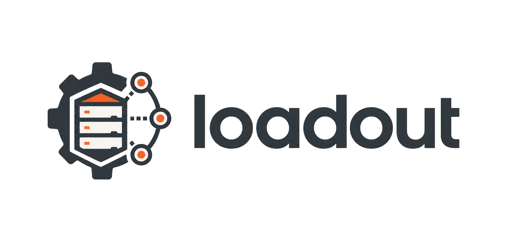

<p align="center">
  
</p>

# loadout

Your agentic gear kit. loadout keeps AI-agent configs — skills, instructions, slash commands, hooks, settings — in one canonical, git-friendly store and installs them into each coding agent's native home through pluggable adapters.

Skills use the open [Agent Skills](https://agentskills.io) standard (`SKILL.md`), so the canonical format is the native format: loadout places them, tracks them, and keeps them in sync everywhere.

**Current release: v1.0.0** — canonical store, sync engine with drift detection, all five agent adapters, external git sources, shareable bundles, builder wizard with crash-safe SDD, AI drafting via your logged-in agents, TUI and embedded web UI ([ROADMAP.md](ROADMAP.md) — v1 complete).

**New here? Read [EXAMPLES.md](EXAMPLES.md)** — a hands-on walkthrough ending with a real Claude session using loadout-installed `/spec` and `/handoff`.

## Why

Agent configs are fragmented across `~/.claude`, `~/.codex`, `~/.gemini`, `~/.cursor` and project `.agents/` directories: no sync, no versioning, no team-sharing, no reinstall story. loadout treats them like dotfiles with a package manager on top:

- **One canonical store** — a plain directory (and git repo) holding your whole setup.
- **Pluggable adapters** — install into Claude Code, Codex, Gemini CLI, Antigravity and Cursor.
- **Drift detection** — see per artifact and per agent what is in sync, edited on disk, updated in the store, or missing.
- **Never writes without asking** — every apply goes through a confirmation gate; user-authored content outside loadout's managed blocks is never touched.

## Install

```bash
go install github.com/AxeForging/loadout/cmd/loadout@latest
```

Or grab a binary from [Releases](https://github.com/AxeForging/loadout/releases).

## Quick start

```bash
loadout init                      # create the canonical store
loadout new skill code-review    # scaffold a skill (SKILL.md standard)
loadout new instruction style    # shared instructions for every agent
loadout status                   # drift matrix: artifact × agent
loadout sync                     # install into detected agents (asks first)
```

## Commands

| Command | Purpose |
|---------|---------|
| `loadout init` | Create the canonical store (git-friendly directory with a starter manifest) |
| `loadout status [artifact...]` | Drift matrix: every artifact's sync state per agent |
| `loadout diff [artifact...]` | Unified diffs of what sync would change |
| `loadout sync [artifact...]` | Install/update artifacts in agent homes — always asks before writing (`--dry-run`, `--yes`, `--agent`) |
| `loadout install <agent>` | First-time full install into one agent |
| `loadout new <kind> <name>` | Scaffold a `skill`, `instruction`, `command` or `hook` — or draft a skill with `--ai "description"` via your logged-in agent |
| `loadout add <path>` | Adopt an existing native artifact (skill/hook dir, command/instruction file) into the store |
| `loadout source add\|list\|remove <url>` | Track skills from external git repos (pinned in `sources.lock.yaml`) |
| `loadout check` | Check sources for updates — `git ls-remote` only, nothing fetched or applied |
| `loadout update [source]` | Fetch updates, show changelog + artifact diff, apply to the store after confirmation |
| `loadout bundle export [--archive]` | Export the whole store as a shareable directory or `.loadout.tar.gz` |
| `loadout bundle import <path>` | Validate a bundle, show the merge plan (`--on-conflict skip\|overwrite`), apply after confirmation |
| `loadout wizard` (alias `create`) | Guided builder: stack + engineering conventions + SDD → generated skills/instructions/commands (`--preset`, `--answers`, `--yes`) |
| `loadout tui` (alias `dash`) | Interactive dashboard: drift matrix, store browser with preview, sources, diff view, gated sync |
| `loadout serve` | Local web UI on `127.0.0.1:4600` — overview, store browser, drift matrix with diffs, sources, the Builder, bundle export |
| `loadout agents` | List supported agents and whether they are installed |
| `loadout doctor` | Verify the store, agent homes, managed-block markers and install state |
| `loadout version` | Print build version information |
| `loadout completion <shell>` | Shell completion scripts (bash, zsh, fish) |

Global flags: `--store <path>` (env `LOADOUT_STORE`), `--log-level` (env `LOADOUT_LOG_LEVEL`), `--no-color`.

## The canonical store

By default at `~/.local/share/loadout/store` (override with `storePath` in `~/.config/loadout/config.yaml` or `--store`). It is a plain directory — point it at your dotfiles repo if you like:

```
store/
├── loadout.yaml            # manifest: artifacts, kinds, targets
├── skills/<name>/SKILL.md  # Agent Skills standard, verbatim
├── instructions/*.md       # concatenated into managed blocks in CLAUDE.md etc.
├── commands/<name>.md      # slash-command prompts
├── hooks/<name>/           # hook.yaml (event/matcher/timeout) + run.sh
└── settings/<agent>.yaml   # per-agent settings fragments (merged, never replaced)
```

Machine-local install state (content hashes per artifact × agent) lives separately in the platform data dir — the store repo stays shareable.

### Sync states

| State | Meaning |
|-------|---------|
| `in-sync` | Agent file matches the store |
| `missing` | Not installed yet |
| `drifted-local` | The agent file was edited after install |
| `drifted-store` | The store was updated after install |
| `conflict` | Both changed, or an unmanaged file is in the way |
| `n/a` | The agent does not support this artifact kind |

### Managed blocks

Instructions render into agents' global instruction files (e.g. `~/.claude/CLAUDE.md`) between sentinel markers:

```markdown
<!-- loadout:begin style -->
...your instruction content...
<!-- loadout:end style -->
```

Everything outside the markers is preserved byte-for-byte. Hooks and settings fragments deep-merge into `settings.json` instead of replacing it.

## External sources

Track skill repos (yours, your team's, public collections) and stay pinned:

```bash
loadout source add git@github.com:acme/team-skills.git
loadout check            # ls-remote only — never fetches or applies
loadout update           # shows changelog + per-skill diff, asks, applies to the STORE
loadout sync             # then rolls the store out to your agents (asks again)
```

Pins live in `sources.lock.yaml` inside the store, so a shared store reproduces the exact same skill versions everywhere. Git operations shell out to your system `git` — private repos work through your existing SSH agent or credential helper, and loadout never stores credentials. Skills you edited locally (origin `local`) are never overwritten by updates; skills that disappear upstream are kept and relabeled `local`, never deleted.

Optional passive checking (off by default) in `~/.config/loadout/config.yaml`:

```yaml
updates:
  checkOnRun: true     # after status/sync, print at most one hint line
  intervalHours: 24    # cache window; failures are always silent
```

## The wizard — conventions in, artifacts out

`loadout wizard` interviews you about what you build (app types, languages, toolchain, docker), your **engineering conventions** (lefthook git hooks, linters, branching model, commit convention, PR-title convention), your **testing strategy** (which levels are mandatory — unit/component/integration/e2e — per framework and runner, plus a mocking policy) and whether you want **spec-driven development** and **cross-agent context handoff**. It generates ready-to-sync artifacts:

- `core`, `toolchain`, `conventions`, `testing` instructions (managed blocks in every agent's instruction file)
- a `commit-and-pr` skill — commit/branch/PR rules with the validation regex, plus a ready `lefthook.yml` in its references
- a `linting` skill with run/fix commands per linter, and `docker-workflows` if you use docker
- `/plan` + `/spec` commands and an `sdd-workflow` skill (light or full spec templates)
- `/handoff` + `/resume` commands and a `context-handoff` skill (see below)

Non-interactive: `loadout wizard --preset go-cli --yes` (presets: `go-cli`, `web-app`) or `--answers answers.yaml`. Existing artifacts are never overwritten — the wizard skips them. Everything generated is plain markdown in the store — edit freely, it's yours.

## Context handoff — continue anywhere

Session context dies with the session. The wizard's continuity artifacts standardize the fix across every agent:

- `/handoff` — the agent dumps a structured handoff (goal, current state, decisions, next steps, gotchas) to `.agents/context/handoff.md` in the project.
- `/resume` — any agent (Claude Code, Codex, Gemini CLI, …) reads it, verifies it against git state, and continues.

Dump from Claude Code, resume in Codex. Or restart tomorrow and pick up exactly where you left off.

## AI drafting — powered by the agents you already pay for

If you're logged into Claude Code, Codex or Gemini CLI, loadout can use them headlessly (`claude -p`, `codex exec` read-only, `gemini -p`) — no API keys, it rides your existing plan:

```bash
loadout new skill release-notes --ai "draft release notes from merged PRs since the last tag"
loadout wizard --preset web-app --ai        # deepens testing/conventions/toolchain for your exact stack
loadout agents                               # HEADLESS column shows what's available
```

Reliability model: deterministic templates are always the base (offline, reproducible); AI output is validated (skills must pass the Agent Skills contract) and previewed behind the same confirmation gate as everything else. `--runner claude|codex|gemini` picks the agent explicitly.

## The web UI

`loadout serve` opens the armory in the browser (embedded in the binary — no separate install): overview with per-agent drift counts, store browser, drift matrix with inline diffs, sources, one-click bundle export, and the **Builder** — the wizard as a multi-step form. Applying changes is a visible two-step ritual: a docked pending bar → review the exact plan → apply. The apply endpoint only accepts a token minted by the plan you just reviewed, so the no-silent-writes promise holds over HTTP too. The server binds to localhost only.

## Bundles — share your whole setup

```bash
loadout bundle export --archive          # → team-kit.loadout.tar.gz
# send it to a teammate / new machine
loadout bundle import team-kit.loadout.tar.gz   # shows the merge plan, asks
loadout sync                                    # installs into their agents
```

A bundle is the store tree plus `bundle.yaml` metadata — a plain directory by default (commit it to a repo) or a single archive with `--archive`. Import never merges silently: new artifacts and unregistered sources are listed, ID conflicts are skipped unless you pass `--on-conflict overwrite`, and nothing happens without confirmation.

## Supported agents

| Agent | Skills | Instructions | Commands | Hooks | Settings |
|-------|--------|--------------|----------|-------|----------|
| Claude Code | ✔ `~/.claude/skills/` | ✔ `CLAUDE.md` block | ✔ `commands/` | ✔ script + `settings.json` merge | ✔ JSON merge |
| Codex | ✔ `~/.codex/skills/` | ✔ `AGENTS.md` block | ✔ as skill | — | — (`config.toml` merge parked: comment-preserving TOML needed) |
| Gemini CLI | ✔ `~/.gemini/skills/` | ✔ `GEMINI.md` block | ✔ as skill | — | ✔ JSON merge |
| Antigravity | ✔ `~/.gemini/antigravity-cli/skills/` | ✔ shared `GEMINI.md` | project-scoped (roadmap) | — | — |
| Cursor | ✔ `~/.cursor/skills/` | project-scoped `.mdc` rules (roadmap) | ✔ as skill | — | — |

Commands render "as skill" on agents whose slash commands are backed by the Agent Skills standard. Unsupported cells show as `n/a` in `loadout status` — nothing is silently skipped.

## Roadmap

See [ROADMAP.md](ROADMAP.md) — all adapters, external skill sources, shareable bundles, a guided builder wizard (including engineering-conventions and spec-driven-development presets), TUI and an embedded web UI.

## Development

```bash
make build              # build bin/loadout
make test               # unit tests (race)
make test-integration   # end-to-end CLI tests against a temp HOME
make ci                 # tidy + lint + test + build
```

## License

MIT
